# PF Guru Ji

Video creation for EPFO guidance: the production pipeline for **PF Guru Ji**, Instagram reels that explain EPFO in plain Hinglish (PF claim settlement, how to fill the claim forms, and the problems members run into, with where to get help) in the paper-collage explainer style. Meta Muse or a person can work through it step by step. Every step is checked, and nothing moves on until its gate is passed.

PF Guru Ji is not EPFO and doesn't speak for it. Every rule a reel states comes from EPFO's own pages, and a person checks each one before the reel can move on.

**To make a reel, give Muse [MUSE.md](MUSE.md).** In short:

- **[MUSE.md](MUSE.md):** the one file Muse follows, with the prompt to paste into Muse.
- **`tools/build_reel.py`:** makes the video from the episode files: paper, header, cards, numbers, stamps, charts, karaoke captions, torn-paper wipes, sound effects and the cover, in the reference reel's style. GitHub runs it by itself when Muse uploads photos or voice (**Actions → Build reel**).
- **`episodes/ep01-claim-reject/`:** the first episode, on why a PF claim gets rejected and how to fix it. Its prompts (photos, voice, every line) are in `prompts.md`.
- **Everything else** (checks, approvals) makes sure no wrong number, rule or form is ever posted. [START-HERE.md](START-HERE.md) explains it.

```mermaid
flowchart LR
  S00[00 Capability test] --> S01[01 Brief]
  S01 -->|person approves| S02[02 Data]
  S02 -->|facts and rules checked| S03[03 Script]
  S03 -->|person approves| S04[04 Shots + prompts]
  S04 -->|checks pass| S05[05 Keyframes]
  S05 -->|OCR + person, per shot| S06[06 Motion]
  S06 -->|OCR + person, per shot| S07[07 Voice]
  S07 -->|person| S08[08 Assembly]
  S08 -->|OCR + person| S09[09 Final QA]
  S09 -->|second person| S10[10 Publish]
  S10 --> S11[11 Measure]
```



## What gets checked

| Layer | What it catches |
|---|---|
| `tools/validate.py` (AUTO) | Any number in the voice, cards or caption that isn't in the episode's data · a form that isn't in `brand/epfo-forms.json` · facts and rules without an official source or a person's check · totals that don't add up · Western digit grouping · example numbers without "maan lo" · gaps in timing · prompts that drift from the episode file · steps approved out of order |
| `tools/verify_media.py` (AUTO) | Reads the cards in images, clips and the finished reel with OCR. Numbers must match digit for digit, and a near-miss such as ₹58,000 for ₹50,000 fails. Also size, length and loudness |
| `tools/verify_voice.py` (AUTO) | Listens to every voice line: each number and the brand name must be heard, and nothing trimmed |
| Self-check prompts (SELF) | Muse re-reads its own work against the required text |
| `tools/approve.py` (HUMAN) | Named approvals only. Approvals signed "Muse", "Claude" or "AI" are refused. Each approval is locked to a fingerprint of the content, so a later edit breaks the chain until it is approved again |
| GitHub Actions | Runs all of the above on every push, plus `tests/`, which break things on purpose to prove each check still works |

## Quick start

```bash
python3 tools/validate.py
```

It prints each episode's steps and a **Next** line saying what to do. Episode 01 (`episodes/ep01-claim-reject`) passes every check; it's waiting for a person to check its facts and rules against EPFO's own pages and to approve the steps. Each one is recorded like this:

```bash
python3 tools/approve.py fact episodes/ep01-claim-reject <data id> --by "Your Name" --note "What you saw, on which official page"
```

```bash
python3 tools/approve.py step episodes/ep01-claim-reject 01-brief --by "Your Name"
```

From episode 05 on, a person reads each new reel's script page (`episodes/<episode>/script.md`, which GitHub writes) and approves its script and hook before anything else is made; nothing is built until then. Muse records the person's OK in `script-approved.json`, or the person records it, with the version on the page they read:

```bash
python3 tools/approve.py script episodes/ep05-uan-activate --version 3fa9c1 --by "Your Name" --words "script OK"
```

Add the names of the people allowed to approve to `approvers` in `brand/brand.json`. With two or more names, final QA must be signed by a different person from the one who approved the assembly. The website and Instagram handle in `brand/brand.json` are still empty: fill them in when you have them.

## What's where

| Path | What it is |
|---|---|
| `START-HERE.md` | The rules and the step map, for Muse and the team |
| `pipeline/` | One file per step: goal, prompt, checks, gate. `pipeline/01-brief.md` has the topic bank |
| `episodes/<episode>/episode.json` | The source of truth: brief, data, script, shots, post |
| `episodes/<episode>/status.json` | Step states, approvals, tries, the post link, metrics |
| `episodes/<episode>/prompts.md` | Generated production prompts (photos, voice lines, every shot) |
| `episodes/<episode>/prompts-writing.md` | Generated script and shot prompts |
| `episodes/<episode>/reel.json` | What each shot shows and when; the build draws it, using only the shot's card text |
| `brand/` | Colours, fonts, chapters, rules, prompt blocks, asset prompts, Muse capability results |
| `brand/epfo-forms.json` | The EPFO forms a reel may name, what each is for, and its official source |
| `brand/assets/` | Style frames, caption strip, safe-zone guide, palette, type specimen, crosshair and loop marks; `plates/paper-a01.webp`, the paper every shot is built on |
| `brand/assets/logo/` | The logo: the Instagram profile picture, the main logo, versions for dark backgrounds and wide spaces, and the mark alone. Its README says which to use where |
| `brand/fonts/` | Anton, IBM Plex Mono, Archivo, Caveat and Courier Prime (open licences) |
| `MUSE.md` | What Muse does, step by step, and the `reel.json` building blocks |
| `tools/` | `build_reel.py` (makes the reel), `check_episode.py` (the check report), `topics.py` (the register and the not-a-repeat checks), `validate.py`, `verify_media.py`, `verify_voice.py`, `approve.py`, `build_prompts.py`, `new_episode.py`, `render_assets.js`, `make_logo.py` |
| `TOPICS.md` | Every reel made so far, written by GitHub after every upload. A new reel never repeats one |
| `brand/topics-done.json` | Reels posted before this repo, so new ones don't repeat them either |
| `episodes/<episode>/posted.json` | The live post's link, written right after posting. Its reel is never posted or rebuilt again |
| `MUSE-TEST-KIT.md` | Step 00: what to test in Muse before trusting it |

## Requirements

- Python 3.9 or newer. `validate.py`, `approve.py`, `build_prompts.py`, `new_episode.py` and `topics.py` use the standard library only (with Pillow, `topics.py` also catches photos that look the same).
- To build reels: ffmpeg, plus `pip install -r requirements-build.txt` (Pillow, numpy, fontTools).
- For media checks: ffmpeg, plus `pip install -r requirements-media.txt` (RapidOCR).
- For the voice check: `pip install -r requirements-voice.txt` (faster-whisper).
- To re-render the brand images (optional): Node with Playwright, then `node tools/render_assets.js`.
- To change the logo: fontTools, then `python3 tools/make_logo.py` and `node tools/render_assets.js logo`.

## Connecting Muse

- **GitHub:** Muse connects through a custom connector it sets up itself (`custom.github`). You enter a GitHub token on Muse's secure page; it stays in Muse's vault, and Muse calls only `api.github.com`. It writes one file per commit; every push runs the checks, and a newer push cancels the run before it.
- **The token:** use a fine-grained token for this one repository, with *Contents: read and write* and nothing else, and an expiry date. Without the *Workflows* permission Muse can't change the checks in `.github/`. A classic token reaches every repository on the account, so replace one if that's what Muse has.
- **Without a connection:** Muse returns each file in a code block headed with its path, a person commits it, and GitHub runs the checks.
- **Instagram:** Muse's built-in connection reads; posting goes through a third-party posting connector. Set it to "Always ask". Step 10 must be approved first.
- **Media:** photos, voice lines and final reels are committed, because Muse writes through the GitHub API and the checks need the files. Expect roughly 50–100 MB per episode; GitHub refuses single files over 100 MB. Past about 1 GB in total, move older episodes' media out of the repo.
